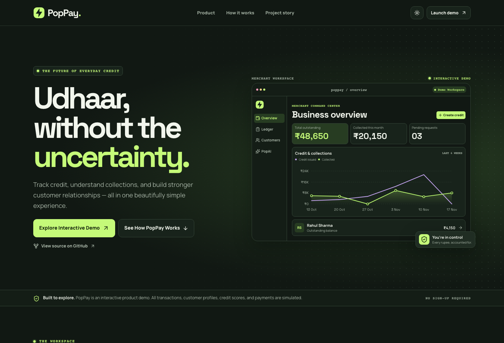
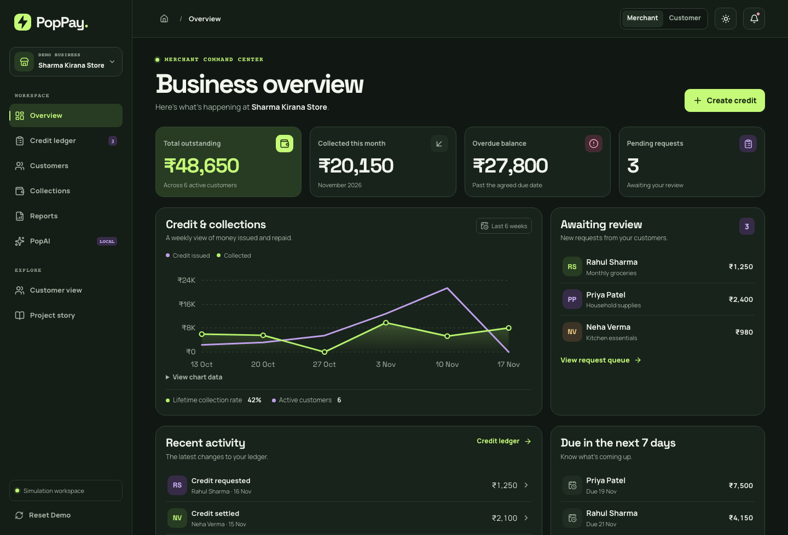

# PopPay 2.0

**Your money. Your people. Your peace of mind.**

PopPay is an interactive simulation of everyday *udhaar* for Indian neighborhood businesses. Open the demo, choose a fictional merchant, create a credit request, share a PopCard, and follow the request through approval, partial repayment and settlement. The merchant and customer views share a local ledger.

**Fictional demo only.** PopPay doesn't issue loans, move money, collect payment credentials or use credit bureau data. Records stay in the current browser and are not backed up.





## Run locally

Use Node.js 24 and npm:

```sh
nvm use
npm ci
npm run dev
```

Open the URL printed by Vite, then select **Explore Interactive Demo**. There is no signup. Three fictional workplaces are preloaded: Sharma Kirana Store, Urban Brew Café and CityStyle Boutique. Switch between them in the workspace menu. **Reset Demo** restores all three businesses and preserves the theme.

## What to try

1. From the overview, select **Create credit**. Choose Rahul Sharma, enter ₹500 and preview and generate the PopCard.
2. Copy its URL. The same browser can open the original request; an isolated browser sees a read-only fictional snapshot.
3. Select **Open as customer** to see the request. Return to **Merchant** and open it from **Awaiting review**.
4. Approve the request, record a partial repayment and settle the rest. Check the receipt and the updated dashboard.
5. Ask **PopAI** “How much is outstanding?” or “Prepare a reminder for Rahul”. Proposed changes require confirmation.
6. Use **Collections** for due-soon and overdue credit, editable templates and follow-up notes. Use **Reports** to export a customer statement, CSV, JSON or a printable PDF.

## How it works

Vite builds one React and TypeScript SPA. React Router resolves record URLs inside the browser. Dexie uses IndexedDB for versioned, atomic updates and tab-to-tab observation; Zod validates requests and saved records. Local storage holds only preferences. If IndexedDB is unavailable, the interface labels the temporary session and work stays in memory until reload.

The ledger stores integer paise. Approval appends one issue entry; repayment appends a separate posting against that request. Dashboard totals, credit aging, customer history, reports and PopAI queries read the same postings. The PopCard QR carries a bounded fictional snapshot in a URL fragment. PopAI recognizes supported intents and uses the selected ledger. It does not call an external model.

PopPay began as a hackathon prototype using Next.js and Supabase, with experiments in PopCards, trust indicators and merchant assistance. This rebuild removes the former auth, API routes, Supabase, external AI, spreadsheet sync and UPI integrations so visitors can explore the full experience with no runtime services. See the in-app **Project story** for the tradeoffs.

## Verification

```sh
npx playwright install chromium
npm run check
```

This runs ESLint, Vitest, TypeScript plus the production build, and Playwright against built files with the Netlify config applied by a local preview server. Browser checks include keyboard-only credit lifecycle, simulated customer payments, same-origin tabs, cross-browser QR preview, fallback storage, seeded merchant isolation, offline reload, responsive widths and axe checks. For separate runs: `npm test`, `npm run build`, `npm run test:e2e`.

Lighthouse 13.6.0 measured 100 for Performance, Accessibility, Best Practices and SEO on both the landing page and project story, using its simulated mobile profile against the local production build. These are lab measurements. The live Netlify domain still needs a deployment smoke test.

## Deploy

`npm run build` writes `dist/`, including a versioned offline asset manifest and service worker. Netlify serves those files with a 200 SPA rewrite for deep links. No environment secrets, functions, database or server are needed. Use `npm run preview` for a quick local preview or `netlify serve --offline` with the Netlify CLI. The intended hostname is **poppay.axvrma.com**. [Deployment and verification guide](docs/DEPLOYMENT.md)

- [Architecture](docs/ARCHITECTURE.md) · [Data model](docs/DATA_MODEL.md) · [Credit engine](docs/CREDIT_ENGINE.md)
- [PopCard](docs/POPCARD.md) · [PopAI](docs/POPAI.md) · [Demo mode](docs/DEMO_MODE.md) · [Security](docs/SECURITY.md)

Designed and built by [Abhishek Verma](https://axvrma.com). [Source repository](https://github.com/axvrma/pop-pay).
