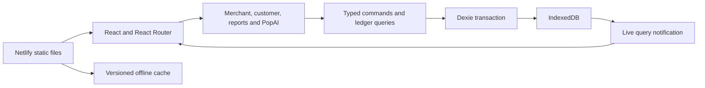

# Architecture

PopPay 2.0 replaces the original Next.js prototype with one client application. The former auth proxy, POST handlers, Supabase database and realtime channels, Gemini, Sheets sync and UPI flow all needed external state or credentials. Static export couldn't keep those runtime interfaces and would need an SPA fallback for IDs generated after deployment anyway. Vite expresses the resulting design directly: one build, static files, browser routes and no server runtime.

`src/core` owns the domain, persistence, exports, share payload and deterministic intent parser. `src/ui` holds the shell and reusable controls, dialogs and charts. `src/pages` combines them into public, merchant or customer journeys. Most routed workspaces are loaded on demand. Product previews use derived seed data and reused chart and card components. Local variable fonts keep rendering independent of a CDN.

A single small IndexedDB document makes a command and its audit data one atomic update. Each merchant owns a separate ID scope; selectors never combine merchants. Normal writes validate the current document, apply the command inside an IndexedDB transaction, check the result, and publish only after commit. Dexie live queries observe transactions in the same page and across same-origin tabs. An enterprise ledger would need separately indexed records, an authenticated service, audit controls, backups and stronger operations and privacy guarantees. This app intentionally does not provide them.
