# Credit engine

```mermaid
stateDiagram-v2
  [*] --> Pending: create request
  Pending --> Rejected: reject
  Pending --> Cancelled: cancel
  Pending --> Issued: approve; append issue
  Issued --> PartiallyRepaid: append repayment
  PartiallyRepaid --> PartiallyRepaid: append repayment
  Issued --> Settled: append full repayment
  PartiallyRepaid --> Settled: repay remaining balance
```

Only a pending request can be approved, rejected or cancelled. A passed due date blocks approval; a merchant can cancel and create a new request. Forms preview or confirm important writes. Only an approved account with a positive balance can accept a repayment, and the amount cannot exceed the balance. Approval checks the customer's total current balance plus the proposed credit against their fictional credit limit.

Amounts are integer paise. Input is parsed as digits and up to two decimal places; decimal text converts without multiplying floating-point rupees. Outstanding is total issue postings less repayment postings. The outstanding balance is overdue starting the day after the due date in Asia/Kolkata. Aging groups current, 1–7, 8–30, 31–60 and 61+ days. Period collections use India calendar days; the week starts Monday.

A retry with the same command and operation ID returns the original result. A different command using that ID is rejected. Competing writes run in IndexedDB read/write transactions. One issue exists per approved request and no issue exists for any other request. Repayments must follow the issue and sum to no more than its principal. Prior postings cannot be modified from the interface; reversal or adjustment operations are outside this demo's scope.

Relationship indicator = 70% on-time settlement rate + 30% overall settlement rate. The denominator includes only issued accounts already settled or overdue. A settlement is on time if the last repayment posted on or before the due date. No indicator is shown without eligible history. It does not affect approval and uses no bureau data.
